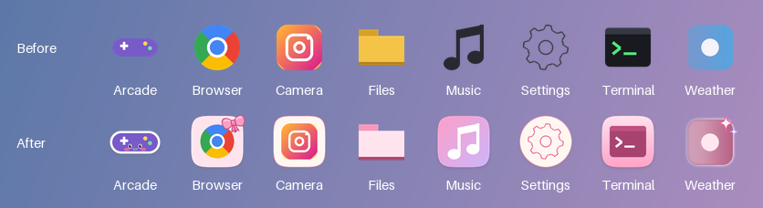
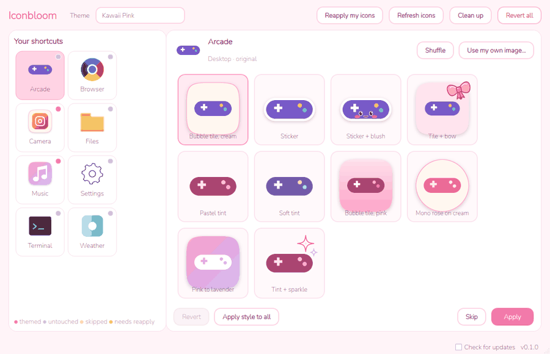

# Iconbloom

Restyle your Windows shortcut icons into one cute, matching theme, one icon at a time. It works offline, results are instant, and you can undo everything with one click.

[](https://github.com/qwopp/iconbloom/actions/workflows/ci.yml)
[](LICENSE)

[](https://github.com/qwopp/iconbloom/releases/latest)





*Screenshots use the sample icons in `tests/samples`, which are drawn for this project.*

## What it does

Iconbloom takes the real icon of each shortcut, folder and desktop icon (even the Recycle Bin) and offers 12 styled versions of it: pastel tints, a pastel recolor that keeps multicolor logos readable, bubble tiles, stickers, a bow, a blush face and more. You pick your favourite for each app, or skip it. Nothing is generated by AI. Every version comes from the app's own icon run through image filters, frames and hand-drawn decorations, so the results are instant, offline and the same every time.

The first theme is **Kawaii Pink**. Themes are plain data files, so new ones need no code (see [docs/THEMES.md](docs/THEMES.md)).

## Using it

1. Install from the [latest release](https://github.com/qwopp/iconbloom/releases/latest) and open Iconbloom. It finds the shortcuts on your desktop, in your Start menu and on your taskbar (game and web shortcuts included), the folders on your desktop, and Windows' own desktop icons.
2. Click an icon. Desktop items come first, and the search box and Desktop / Taskbar / Start menu tabs find the rest. If an app has shortcuts in several places (desktop, Start menu, taskbar), they're one tile and get styled together. You'll see its styled versions, with the ones that suit that icon first. Hover one to compare it with the original at desktop size.
3. Click **Apply** (or double-click a style). Iconbloom moves on to the next shortcut. Click **Skip** to leave one as it is.
4. **Shuffle** re-rolls the decorations and shades. **Use my own image…** lets you use any PNG, for example from an icon pack you bought.
5. Ctrl-click or Shift-click to select several shortcuts: the chosen style is shown on all of them, and **Apply** styles them together.
6. **Revert** puts the selected icons back. **Revert all** puts every icon back.

## What it can and can't change

Iconbloom only ever changes which icon something shows. It never changes what a shortcut opens, and never edits apps or program files. Depending on the item, the icon setting lives in one of three places:

- **Shortcuts** (`.lnk`, and `.url` for web links and most Steam or Epic games): the icon field inside the shortcut file.
- **Folders:** a hidden `desktop.ini` file inside the folder, the same one Windows' own *Properties → Customize → Change Icon* writes. If your Desktop syncs with OneDrive, that file syncs too, so the folder looks the same on your other PCs.
- **Recycle Bin, This PC, Network and your user folder:** your own user's registry setting, the same one Windows' *Desktop icon settings → Change Icon* writes. Nothing outside those icon settings is touched, and no administrator permission is needed.

| Where | Changes? | Notes |
|---|---|---|
| Desktop shortcuts | Yes | Including game and web shortcuts |
| Desktop folders | Yes | |
| Recycle Bin, This PC, Network, user folder | Yes | The Recycle Bin gets a styled empty *and* full version; This PC and friends show the new icon in File Explorer too |
| Start menu, your apps | Yes | Also changes Start pins that point to those shortcuts |
| Start menu, apps installed for all users | Yes | Shared by everyone on the PC, so Windows asks for permission first; marked with a shield |
| Taskbar pins | Yes | Windows may only show the change after **Refresh icons** |
| Running apps that aren't pinned | No | The taskbar uses the program's own icon |
| Microsoft Store apps in Start | No | They aren't shortcut files; a desktop shortcut to one can still be themed |
| Search results, Alt+Tab, title bars | No | Those come from the app itself |

## Safety

- Before Iconbloom changes anything for the first time, it saves an exact copy of what decides its icon: the shortcut file, the folder's `desktop.ini` (or the fact that there wasn't one), or the registry values. The copies go in `%LOCALAPPDATA%\Iconbloom\backup.json` and `originals\`.
- **Revert** and **Revert all** put those copies back exactly when nothing else has touched the item since. Otherwise they put back the original icon setting. Shortcuts shared by every user get their original icon setting back.
- The helper that changes shared shortcuts with administrator permission only ever changes the icon of shortcut files in the shared Start menu and desktop folders, and checks that itself.
- If the backup file is ever damaged, Iconbloom refuses to change anything until it's fixed, and it never overwrites the file.
- The uninstaller offers to put all your original icons back first.

## Privacy

Iconbloom collects no data. The only network request it can make is checking for updates, and it asks you first, the first time it opens. If you say yes, it asks GitHub whether a newer version exists each time it starts. When there is one, **Update now** downloads the official installer, checks it against the SHA-256 checksum published with the release, and installs it; your icons and backups stay as they are. Nothing is downloaded or installed unless you click it. You can switch the check off at the bottom of the window.

## FAQ

**Windows says "Windows protected your PC" when I run the installer.**
Releases aren't code-signed yet, so Windows SmartScreen doesn't recognize the publisher. Click **More info**, then **Run anyway**. To check that your download is the real one, compare its SHA-256 hash with `SHA256SUMS.txt` on the release page (in PowerShell: `Get-FileHash Iconbloom-Setup-0.2.0.exe`).

**My antivirus flagged it.**
Apps packaged with PyInstaller sometimes trigger false positives. Iconbloom ships as a folder rather than a single self-extracting file, which helps. The full source is here, and you can build it yourself (see below).

**I applied an icon but it still looks the same.**
Windows caches icons aggressively, taskbar pins most of all. Iconbloom tells Windows which shortcuts changed and refreshes its icon cache, and shows a **Refresh icons** button when a taskbar pin was involved. That rebuilds the icon cache and restarts Explorer (you'll be asked first). As a last resort, unpin and re-pin the app.

**An app update reset my icon.**
Some installers rewrite their shortcuts. Choose **More → Reapply my icons** and Iconbloom puts back the style you picked.

**How do I undo everything?**
Click **Revert all**, or uninstall and answer **Yes** when asked about restoring icons. From a terminal, you can also run `Iconbloom.exe --revert-all`.

**Where are my files?**
Everything Iconbloom creates lives in `%LOCALAPPDATA%\Iconbloom`: generated icons, backups, your choices, settings and logs. **More → Delete unused icon files** removes generated icons that no shortcut uses any more.

## Build from source

You need Windows 10 or 11 and [uv](https://docs.astral.sh/uv/).

```powershell
git clone https://github.com/qwopp/iconbloom
cd iconbloom
uv sync
uv run python -m app.main              # the app
uv run pytest                          # the tests
uv run python -m app.cli scan          # list shortcuts without changing anything
```

To preview a theme on any OS without touching shortcuts, render a contact sheet:

```bash
uv run python -m engine.sheet tests/samples -o contact_sheet.png
```

To build the installer, also install [Inno Setup 6](https://jrsoftware.org/isinfo.php), then run:

```powershell
uv sync --group release
uv run pyinstaller installer/iconbloom.spec --noconfirm
iscc /DAppVersion=0.2.0 installer\iconbloom.iss
```

See [CONTRIBUTING.md](CONTRIBUTING.md) for how the project is checked and [docs/ARCHITECTURE.md](docs/ARCHITECTURE.md) for how it fits together.

## License

[MIT](LICENSE). The bundled Nunito font is under the SIL Open Font License ([app/ui/fonts/OFL.txt](app/ui/fonts/OFL.txt)). The Kawaii Pink decorations and the sample icons were drawn for this project.
